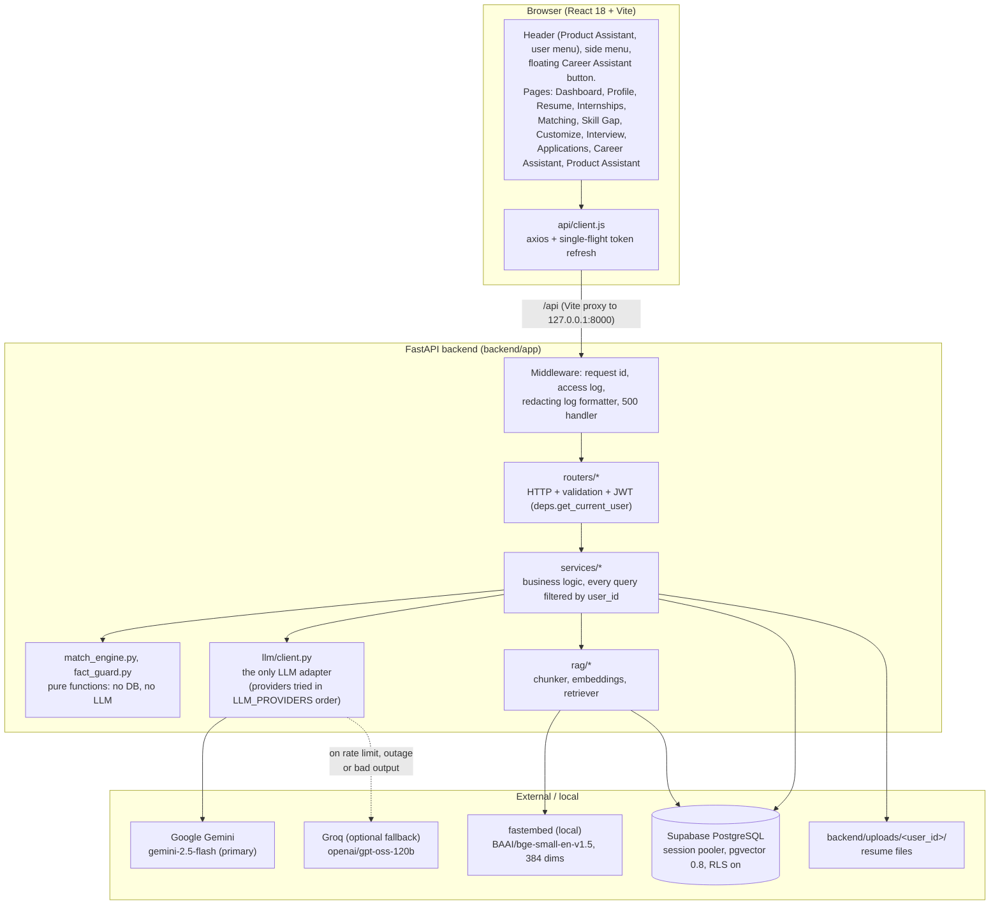
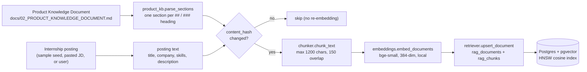
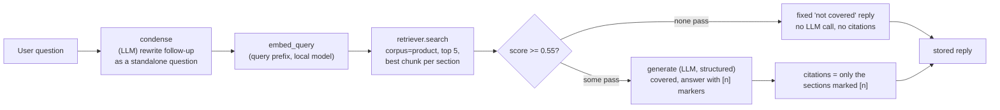
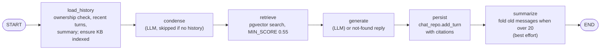
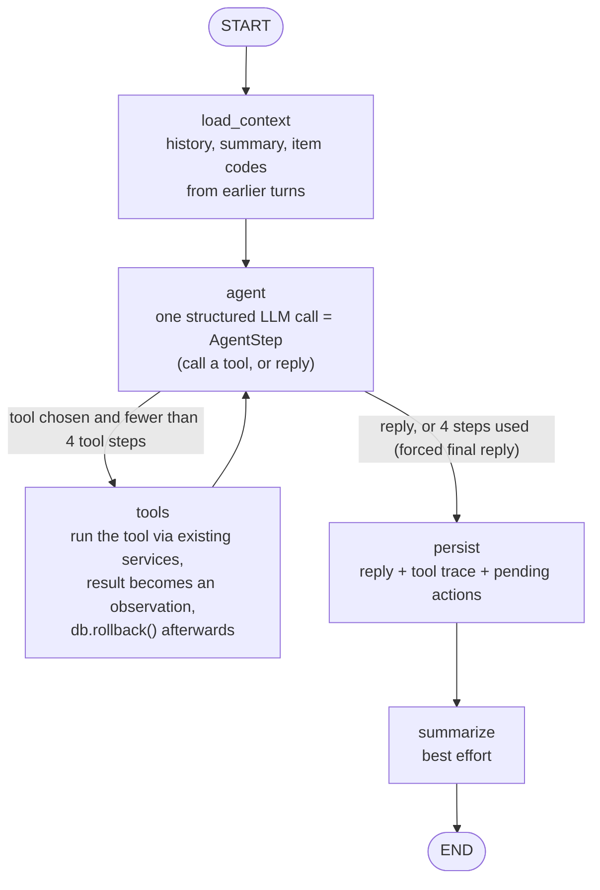
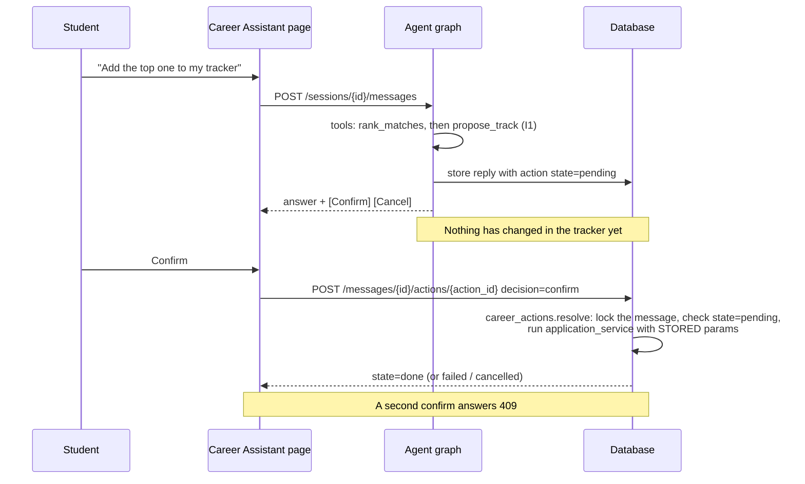

# AI Career Companion: Diagrams

All diagrams are Mermaid and were written from the code (not copied from the blueprint). They render on GitHub and in most Markdown viewers.
Source files are named in each section so they can be checked.

## 1. System architecture

Notes: LLM and embedding calls happen outside database transactions (the service rolls back first and persists afterwards). Only verified skills reach the matching and gap code. If Gemini fails, the same prompt goes to Groq (when `GROQ_API_KEY` is set) and the answer is validated against the same schema; if every provider fails, the user sees an error and nothing is stored.

## 2. RAG pipeline

Both the internship search and the Product Assistant use the same code in `app/rag/`, with different `corpus` values (`internship`, `product`).

### 2.1 Indexing

Run `python -m app.seed` to (re)index the sample internships and the product document. Embedding happens before the database transaction opens.

### 2.2 Answering (Product Assistant)

## 3. Product Assistant graph

`services/product_assistant.py` (LangGraph, strictly linear). `assistant_type='product'`.

If generation fails nothing is stored and the router answers 503 with the adapter's user-safe message.

## 4. Career Assistant graph

`services/career_assistant.py` (LangGraph with a tool loop). `assistant_type='career'`. Separate router (`/api/chat/career`), prompts and tools from the Product Assistant; it never reads the product corpus.

Tools (all read from services, same rules as the pages): `get_profile`, `search_internships`, `rank_matches`, `score_match`, `skill_gap`, `interview_questions`, `list_applications`, plus the two write **proposals** `propose_track` and `propose_status`.

### Confirm-to-write

The model never changes data. A proposal is stored as a pending action on the reply; only a click executes it, using the stored parameters.

Item codes: the model only ever sees `I<n>` (internship) and `A<n>` (application). The server maps codes to ids; an unknown code is an error observation.

## 5. Database schema (ER)

Generated from the SQLAlchemy models (`app/models`). Every table has Row Level Security enabled; `tests/test_integration_db.py` fails if one does not. `rag_chunks.embedding` is `vector(384)` on Postgres.

```mermaid
erDiagram
    users ||--o| student_profiles : has
    users ||--o{ resumes : uploads
    users ||--o{ student_skills : has
    users ||--o{ refresh_tokens : holds
    users ||--o{ email_tokens : "verifies with"
    users ||--o{ applications : tracks
    users ||--o{ application_events : owns
    users ||--o{ chat_sessions : owns
    users ||--o{ chat_messages : owns
    users ||--o{ message_feedback : gives
    users ||--o{ generated_documents : saves
    users ||--o{ interview_sessions : practises
    users ||--o{ interview_items : owns
    users |o--o{ internships : "creates (source=user)"

    resumes ||--o| resume_extractions : "latest parse"
    resumes |o--o{ student_skills : "evidence from"
    resumes |o--o{ applications : "used in"

    skills ||--o{ student_skills : "status: extracted / verified / rejected"
    skills ||--o{ internship_skills : "required / preferred"
    internships ||--o{ internship_skills : lists
    internships |o--o{ applications : "linked (NULL = external)"
    internships |o--o{ generated_documents : "tailored for"
    internships |o--o{ interview_sessions : "practised for"

    applications ||--o{ application_events : "status history"

    chat_sessions ||--o{ chat_messages : contains
    chat_messages ||--o{ message_feedback : rated
    interview_sessions ||--o{ interview_items : questions
    rag_documents ||--o{ rag_chunks : "split into"

    users {
        uuid id PK
        string full_name
        string email
        string hashed_password
        bool is_active
        datetime email_verified_at
    }
    email_tokens {
        uuid user_id FK
        string purpose
        string token_hash
        datetime expires_at
        datetime used_at
    }
    student_profiles {
        uuid user_id FK
        string college
        string degree
        string branch
        float cgpa
        int graduation_year
        string target_role
    }
    resumes {
        uuid id PK
        uuid user_id FK
        string original_filename
        string label
        text raw_text
        bool is_active
        string extraction_status
    }
    resume_extractions {
        uuid resume_id FK
        json data
        string method
    }
    skills {
        uuid id PK
        string canonical
        string name
        string category
    }
    student_skills {
        uuid user_id FK
        uuid skill_id FK
        string status
        string source
        uuid resume_id FK
    }
    internships {
        uuid id PK
        string title
        string company
        text description
        string source
        string seed_key
        uuid created_by FK
    }
    internship_skills {
        uuid internship_id FK
        uuid skill_id FK
        string importance
    }
    applications {
        uuid id PK
        uuid user_id FK
        uuid internship_id FK
        string company
        string role
        string status
        date deadline
    }
    application_events {
        uuid application_id FK
        string from_status
        string to_status
        string note
    }
    chat_sessions {
        uuid id PK
        uuid user_id FK
        string assistant_type
        text summary
        int summarized_count
    }
    chat_messages {
        uuid id PK
        uuid session_id FK
        int seq
        string role
        text content
        json citations
        json tool_calls
    }
    message_feedback {
        uuid message_id FK
        uuid user_id FK
        int rating
    }
    generated_documents {
        uuid id PK
        uuid user_id FK
        string kind
        json content
        json flagged
    }
    interview_sessions {
        uuid id PK
        uuid user_id FK
        string role
        uuid internship_id FK
    }
    interview_items {
        uuid session_id FK
        text question
        string category
        int score
        json feedback
    }
    rag_documents {
        uuid id PK
        string corpus
        string source_key
        string content_hash
    }
    rag_chunks {
        uuid document_id FK
        string corpus
        int chunk_index
        text content
        vector embedding
    }
    refresh_tokens {
        uuid user_id FK
        string token_hash
        bool revoked
    }
```

`chat_sessions.assistant_type` (`product` or `career`) keeps the two assistants' chats apart; `services/chat_repo.py` is the only code that reads or writes chat rows and always filters by user and assistant type.
